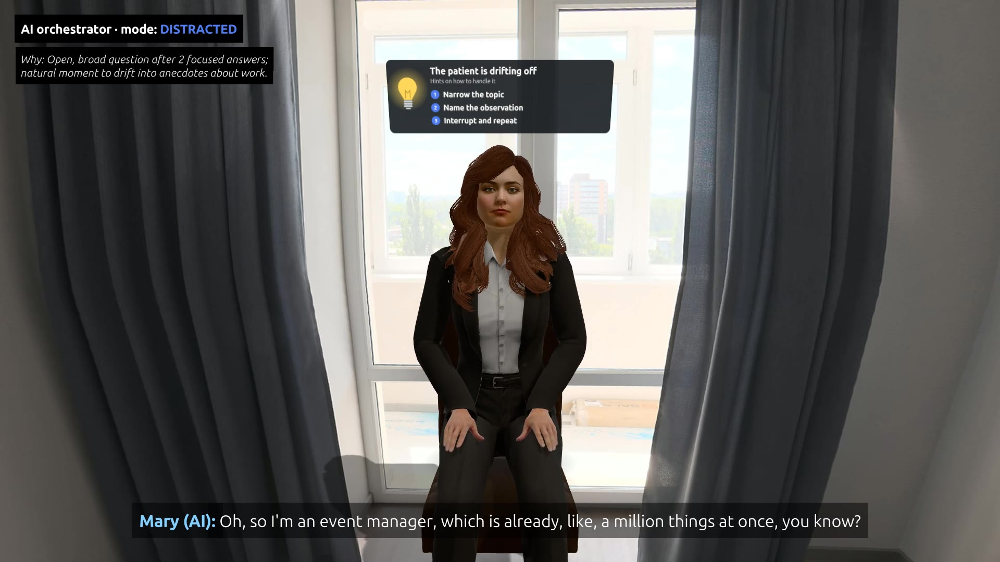
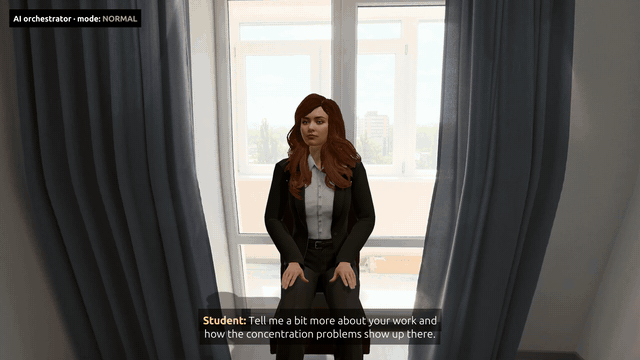
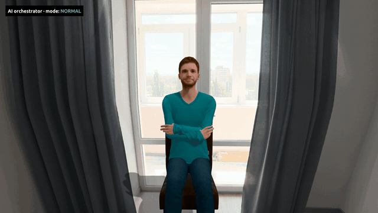
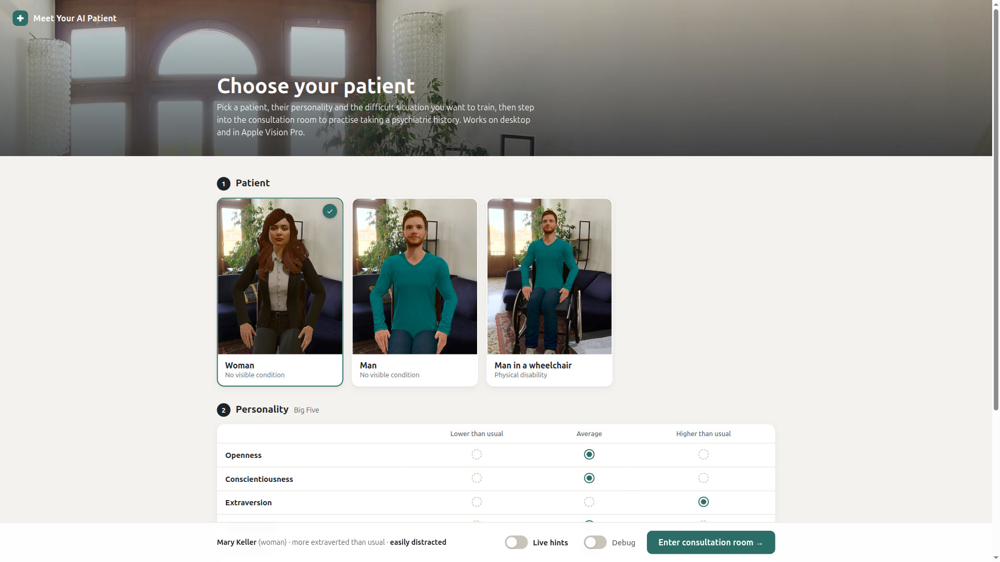
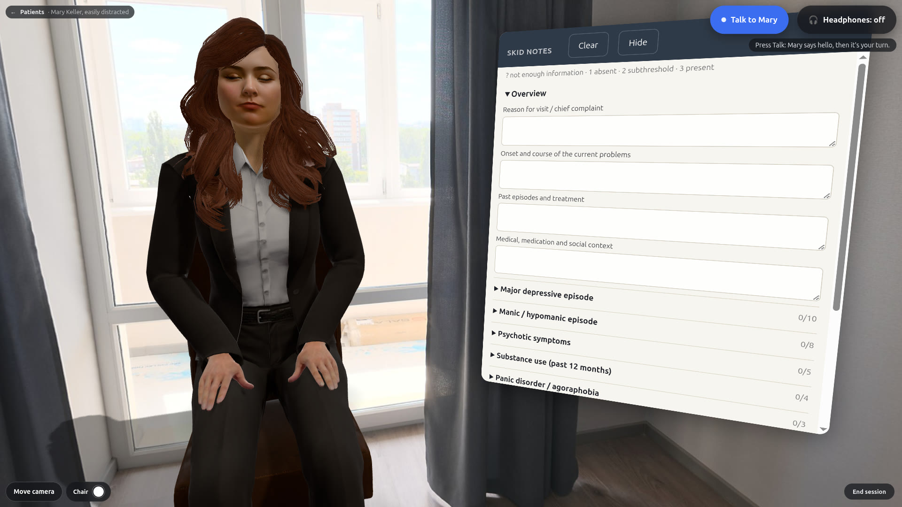
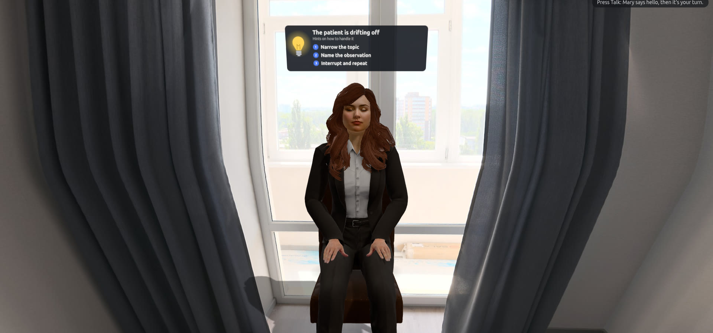
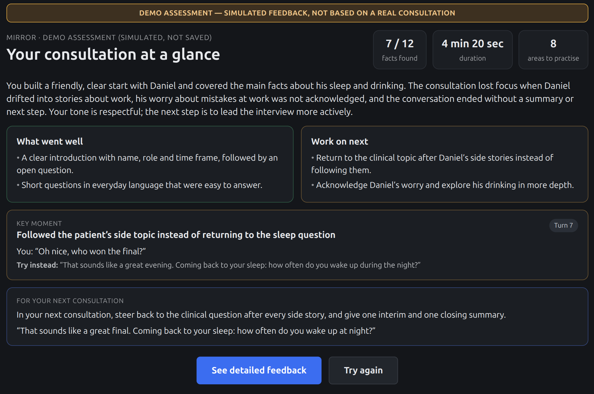
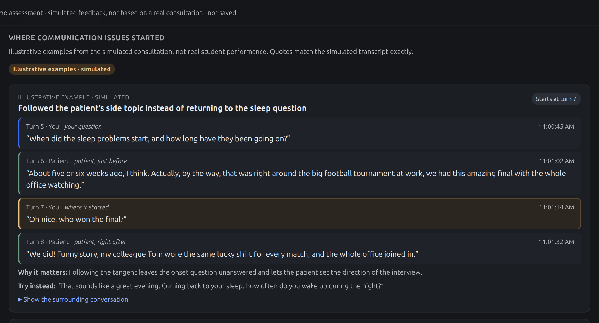
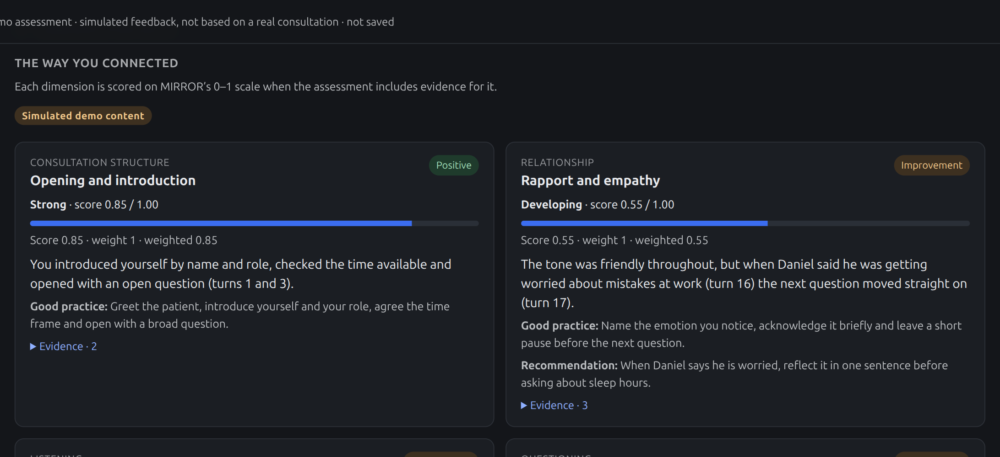
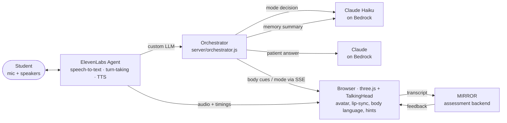

<div align="center">

# PsyTrain · Meet Your AI Patient

**Practise psychiatric history-taking with a virtual patient who listens, talks back, drifts off or gets angry, and then tells you what you could have done better.**

Runs in desktop Chrome and on Apple Vision Pro (WebXR).




</div>

---

## Why

Every medical and psychology student has to learn how to take a history from a patient who doesn't cooperate. Today they learn it from a textbook, from expensive actors, or on real patients. An actor can't play the same case ten times in a row, and afterwards nobody can point to the sentence where the interview went wrong.

PsyTrain gives students a patient they can practise on as often as they want. They build a case in three clicks, sit down with a life-size patient in a 3D consultation room, talk to them out loud, and get turn-by-turn feedback at the end.

PsyTrain was built at the OTH Amberg-Weiden hackathon for the challenge *"Meet Your AI Patient: reinvent medical history-taking with AI and Apple Vision Pro"*.

## Demo

<table>
<tr>
<td width="50%" valign="top">

**Mary, easily distracted.** An open question sends her off on tangents about work and the plant in the corner. A light bulb appears with three strategies. The student names the drift, repeats the question, and Mary answers again.

<a href="pitch/media/demo-distracted.mp4"></a>

▶ [Watch the full video with sound (53 s)](pitch/media/demo-distracted.mp4)

</td>
<td width="50%" valign="top">

**Ryan, aggressive.** "Calm down, you might have anger issues" switches him to aggressive and he crosses his arms. The student names the feeling and gives him control, and he de-escalates.

<a href="pitch/media/demo-aggressive.mp4"></a>

▶ [Watch the full video with sound (43 s)](pitch/media/demo-aggressive.mp4)

</td>
</tr>
</table>

> The patient's answers, mode labels and "Why:" lines in these videos are real model output from the project's orchestrator. The student's lines were voiced with ElevenLabs TTS so the audio is clear. Raw transcripts are in [`pitch/media/`](pitch/media/).

## How a session works

### 1. Build a case

Choose the patient, set their Big Five personality, and pick the difficult situation you want to train (*easily distracted* or *aggressive*). Turn on **Live hints** if you want help during the interview.



### 2. Interview the patient

You sit across from a life-size patient in a photo-real room. Press **Talk** and speak normally. The patient answers in their own voice, with lip-sync, facial expressions, gaze and body language that follow the conversation: fidgeting, crossed arms, looking around the room, shrugs and nods.

Turn slightly to the right and the **SKID notes** form sits next to the patient, so you can document the structured clinical interview as you go. It autosaves per case.



### 3. Get help in the moment

With hints on, a light bulb appears behind the patient as soon as they drift off or become aggressive. It shows three strategies for that behaviour, such as *Narrow the topic*, *Name the observation* or *Interrupt and repeat*. This also works inside VR.



### 4. Review with MIRROR

Click **End session** and MIRROR reviews the transcript. It scores ten communication skills, lists the facts the patient revealed and the ones you missed, and points to the exact turn where the interview went off track, with a better sentence to try. Then press **Try again**.

<table>
<tr>
<td width="50%"></td>
<td width="50%"></td>
</tr>
<tr>
<td colspan="2"></td>
</tr>
</table>

<sub>These screenshots show MIRROR's built-in demo assessment, which is labelled as simulated in the UI. A scored assessment of a real session needs the MIRROR backend running (see <a href="#mirror-feedback-optional">MIRROR feedback</a>).</sub>

## Features

- **A patient who behaves like one.** Before every answer, an orchestrator decides whether the patient stays in *normal* mode or switches into the situation's difficult behaviour. The decision depends on what you said: open questions can cause drift, and labels or lectures can cause aggression. Good interventions bring the patient back.
- **Safe by design.** Questions about suicide, self-harm or harming others are always answered directly, whatever mode the patient is in. Stage directions, markdown and emojis are filtered out before the text is spoken.
- **Body language that matches the words.** Each answer carries a body cue, so the gesture lands on the first word. Fidgeting, foot tapping, posture shifts, gaze and breathing all follow the patient's emotion and personality.
- **Personality you can configure.** Big Five traits change face, posture, gaze and body language. Three patients are included: a woman, a man, and a man in a wheelchair, each with their own voice and backstory.
- **Live hints** during the interview and **MIRROR feedback** afterwards, with a progress dashboard across sessions.
- **Desktop and Vision Pro.** The same page runs in Chrome and in Safari on the headset through WebXR.

## Architecture



| Layer | What it does | Where |
|---|---|---|
| 3D room and avatar | three.js scene, a 360° photo room, a TalkingHead avatar with lip-sync driven by ElevenLabs character timings | `src/scene.js`, `src/photoroom.js`, `src/patient.js`, `src/lipsync.js` |
| Body language | Emotion and personality profiles, procedural fidgeting, gaze, posture and hand-contact correction | `src/affect.js`, `src/bodylang.js`, `src/personality.js`, `src/contacts.js` |
| Voice | ElevenLabs Conversational Agent over WebSocket. The API key stays on the server | `src/conversation.js`, `server/elevenlabs.js` |
| Orchestrator | Chooses the mode, writes the answer, keeps a running memory and runs the safety checks | `server/orchestrator.js`, `ai-patient-voice/prompts/` |
| Live director | Puts the patient into conversation states (engaged, uneasy, storytelling and others) after each turn | `src/agent.js`, `shared/agent-tools.js` |
| Hints and notes | Strategy board and SKID notes form | `src/hints.js`, `ai-patient-voice/hints.json`, `src/skid.js` |
| Feedback | MIRROR client, feedback view and progress dashboard | `src/mirror/` |

## Quick start

**Requirements:** Node 18+ and a recent Chrome. For voice conversations you also need an ElevenLabs API key and either AWS credentials for Amazon Bedrock or an Anthropic API key.

```bash
git clone https://github.com/DEBANJANAB991/PsyTrain.git
cd PsyTrain
npm install
cp .env.example .env      # add your keys (optional for a first look)
npm run dev               # http://localhost:5173
```

Without any keys you can still build a case, explore the room, see the body language, and try the debug panel (`?debug=1`). The patient falls back to a demo voice and simple offline rules.

### Live voice conversations

The ElevenLabs agent has to reach the orchestrator on your machine, so it needs a public HTTPS tunnel:

```bash
cloudflared tunnel --url http://localhost:5173
cd ai-patient-voice && pip install -r requirements.txt
python create_agent.py    # first time; afterwards: python update_agent.py
```

A quick tunnel gets a new address every time it restarts. Run `update_agent.py` again after restarting `cloudflared`. When testing, saying **"Bingo"** always flips the patient's mode.

### Apple Vision Pro

WebXR needs HTTPS. Open the `https://….trycloudflare.com` URL from the tunnel in Safari on the headset and tap **ENTER VR**.

### MIRROR feedback (optional)

The **End session** button sends the transcript to the MIRROR assessment backend, a FastAPI service the dev server proxies at `/api/consultations`. The default address is `http://127.0.0.1:8000`; set `MIRROR_API_URL` to change it. If you end a session before saying anything, a demo assessment labelled as simulated is shown instead. It is never saved.

### Tests

```bash
npm test
```

The tests run the orchestrator end to end with a scripted model (auth, mode triggers, the risk check, timeouts, the speech filter, memory, and every prompt for every patient). They also cover the director endpoint, fuzz the agent tools, and test the MIRROR feedback and progress models.

## Documentation

- **[Technical reference](docs/TECHNICAL.md)** covers the code map, the `setAffect` interface, agent tools, orchestrator internals, body-language tuning, the room and avatar setup, and the vendor patches.
- **[Voice agent](ai-patient-voice/README.md)** covers the ElevenLabs agent setup, the personas, and the prompt structure.
- **[Pitch](pitch/SCRIPT.md)** has the 3-minute pitch script and how the demo media was made.

## Status

| | |
|---|---|
| ✅ Done | Case builder, 3D room, seated avatar with moods and body language, ElevenLabs voice with lip-sync, orchestrated *distracted* and *aggressive* modes, live hints, SKID notes, MIRROR feedback and progress dashboard |
| 🧪 Needs testing | A full classroom session on a real Apple Vision Pro, including gaze following the headset |
| 🔜 Next | More Big Five levels (only *extraversion: higher than usual* is modelled so far), more difficult situations, more patients |

## Credits

**Team:** Harsh Khandelwal, Parisa Bastani, Debanjona Bhattacharjya, Andreas Weigert.

Built on:

- [TalkingHead](https://github.com/met4citizen/TalkingHead) by Mika Suominen (MIT) for the avatar face, lip-sync and skeleton. A patched copy is vendored in `src/vendor/talkinghead/`.
- [three.js](https://threejs.org/) for rendering and WebXR.
- [ElevenLabs](https://elevenlabs.io/) for speech recognition, turn-taking and voices.
- [Claude](https://www.anthropic.com/claude) on [Amazon Bedrock](https://aws.amazon.com/bedrock/) for the orchestrator, patient answers and director.
- [Poly Haven](https://polyhaven.com/) for the room photos, HDR lighting and chair model (CC0).

> **Asset licences.** The default avatars, `avaturn.glb` (Avaturn) and `avatarsdk.glb` (AvatarSDK / MetaPerson), are licensed for **non-commercial use only**. `mpfb.glb` is CC0. Check these terms before any commercial use.
